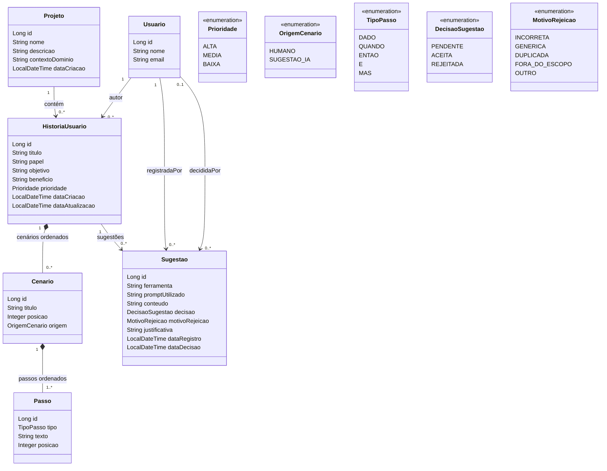

# Diagrama de classes inicial

Diagrama baseado no modelo sugerido no enunciado. Pode ser renderizado por visualizadores Mermaid.

Observações:
- `Cenario` e `Passo` foram modelados com composição via `cascade = ALL` e `orphanRemoval = true` para que a remoção do cenário remova seus passos.
- A validação da ordem dos passos é regra de negócio e ainda precisa ser implementada no service.
- A unicidade de título de história é composta por projeto + título; a unicidade de cenário é história + título.
